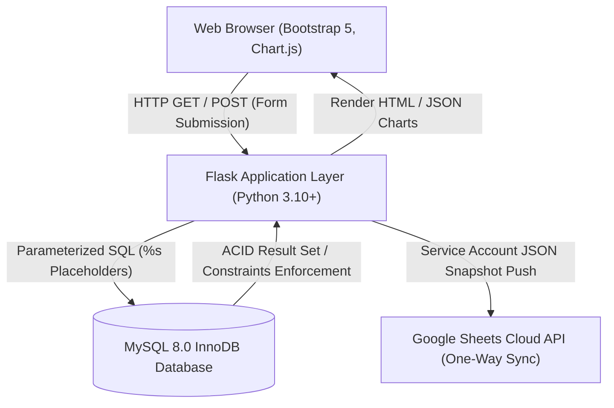

# Student Academic Progression and Portfolio Management System
## Comprehensive User & Technical Report (College Evaluation Edition)

---

## 1. Project Overview & Objectives
Academic progression tracking in collegiate institutions is frequently impeded by disparate, fragmented records. Standard institutional workflows often rely on disconnected spreadsheets that lack referential integrity, permit duplicate entries, fail to validate grade-point boundaries, and obscure critical academic intervals such as approved drop/gap years.

The **Student Academic Progression and Portfolio Management System** resolves these structural deficiencies by establishing a unified, normalized relational database management system using **MySQL 8.0** and **Python Flask**. 

### Primary Objectives:
1. **Normalized Data Modeling:** Implement a relational database adhering strictly to **Third Normal Form (3NF)** to eliminate update, deletion, and insertion anomalies.
2. **Comprehensive Progression Monitoring:** Record multi-semester SGPA and CGPA trends, segregated theory and laboratory examination scores, and pre-college qualifying benchmarks (Secondary and Higher Secondary/Diploma).
3. **Portfolio & Hiatus Tracking:** Formally document technical/co-curricular/extra-curricular accomplishments and track approved academic drop/gap years with duration calculations and rationale logging.
4. **Visual Analytics:** Plot real-time dynamic progression curves using **Chart.js** with explicit visual markers for hiatus periods.
5. **Authoritative One-Way Cloud Sync:** Export verified relational snapshots to **Google Sheets** via service-account authentication without compromising database autonomy.

---

## 2. Relational Database Design & 3NF Normalization Justification

### Theoretical Foundation:
- **First Normal Form (1NF):** All attributes contain strictly atomic, scalar values. There are no repeating groups, composite arrays, or comma-delimited strings within table cells.
- **Second Normal Form (2NF):** The relation is in 1NF and every non-prime attribute is fully functionally dependent on the entire primary key (no partial dependencies on a subset of a composite key).
- **Third Normal Form (3NF):** The relation is in 2NF and no non-prime attribute is transitively dependent on any candidate key (no $X \rightarrow Y$ where $Y \rightarrow Z$).

### Table-by-Table Normalization Breakdown:

#### 1. `students` (Student Demographic Profile)
- **Primary Key:** `student_id` (Surrogate integer).
- **Candidate Key:** `roll_no` (Natural unique college identifier), `email` (Unique).
- **1NF:** Each attribute (`first_name`, `last_name`, `email`, `phone`, `admission_year`, `current_status`) holds a single atomic value.
- **2NF:** All attributes depend on the single-column primary key `student_id`.
- **3NF:** No transitive dependencies exist. `current_status` depends directly on `student_id`, not on `admission_year` or names.

#### 2. `academic_history` (Pre-College Qualification Benchmarks)
- **Primary Key:** `history_id`.
- **Foreign Key:** `student_id` referencing `students(student_id)` ON DELETE CASCADE.
- **3NF Justification:** Avoids repeating multi-qualification arrays (10th, 12th, Diploma) within the `students` table. Each qualification entity depends solely on its own primary key `history_id` and is tied to the parent student. Marks obtained, total marks, and percentage relate exclusively to that specific academic milestone.

#### 3. `semesters` (Semester Progression Ledger)
- **Primary Key:** `semester_id`.
- **Candidate Key:** `(student_id, semester_no)` enforced via `UNIQUE KEY`.
- **Foreign Key:** `student_id` referencing `students(student_id)` ON DELETE CASCADE.
- **3NF Justification:** Moving semester-specific performance metrics (academic year, SGPA, CGPA, gap indicators) out of the parent student entity eliminates repeating columns (`sem1_sgpa`, `sem2_sgpa`, etc.). Every attribute is fully dependent on the student-semester pair.

#### 4. `subjects` (Curriculum Course Catalog)
- **Primary Key:** `subject_id`.
- **Candidate Key:** `subject_code` (Unique).
- **3NF Justification:** Courses exist independently of student enrollments. Course title, course type (`Theory` or `Lab`), and credit values depend strictly on `subject_id` / `subject_code`, preventing redundancy across thousands of student records.

#### 5. `semester_subject_marks` (Many-to-Many Junction Entity)
- **Primary Key:** `mark_id`.
- **Composite Unique Constraint:** `UNIQUE (semester_id, subject_id)`.
- **Foreign Keys:** `semester_id` referencing `semesters(semester_id)` and `subject_id` referencing `subjects(subject_id)` ON DELETE CASCADE.
- **3NF Justification:** Resolves the Many-to-Many relationship between semesters and subjects. Internal marks, external marks, practical marks, total marks, and grade depend entirely on the composite relationship `(semester_id, subject_id)`. Moving marks here prevents update anomalies if a subject's credits or name changes.

#### 6. `seminars` (Technical Presentations)
- **Primary Key:** `seminar_id`.
- **Foreign Key:** `student_id` referencing `students(student_id)` ON DELETE CASCADE.
- **3NF Justification:** Segregates presentation events into discrete normalized records with category tagging (`Internal` departmental vs `External` conferences).

#### 7. `activities` (Portfolio Achievements)
- **Primary Key:** `activity_id`.
- **Foreign Key:** `student_id` referencing `students(student_id)` ON DELETE CASCADE.
- **3NF Justification:** Normalizes extracurricular and co-curricular achievements (`Technical`, `Co-curricular`, `Extra-curricular`), logging title, role, organizer, and certificate verification URLs.

#### 8. `drop_years` (Academic Gap & Hiatus Intervals)
- **Primary Key:** `drop_id`.
- **Foreign Key:** `student_id` referencing `students(student_id)` ON DELETE CASCADE.
- **3NF Justification:** Formally models temporal hiatus intervals (`year_start`, `year_end`, `reason`) separately from ongoing active semester records.

---

## 3. Relational Schema Data Dictionary & Constraints Matrix

| Table Name | Primary Key | Foreign Keys & Cascades | Unique Constraints | CHECK Constraints |
| :--- | :--- | :--- | :--- | :--- |
| `students` | `student_id` | None | `roll_no`, `email` | None |
| `academic_history` | `history_id` | `student_id` &rarr; `students` (CASCADE) | None | `marks_obtained >= 0`, `marks_total > 0`, `percentage BETWEEN 0 AND 100` |
| `semesters` | `semester_id` | `student_id` &rarr; `students` (CASCADE) | `(student_id, semester_no)` | `semester_no BETWEEN 1 AND 12`, `sgpa BETWEEN 0 AND 10`, `cgpa BETWEEN 0 AND 10`, `gap_years BETWEEN 0 AND 10` |
| `subjects` | `subject_id` | None | `subject_code` | `credits >= 0` |
| `semester_subject_marks` | `mark_id` | `semester_id` &rarr; `semesters` (CASCADE), `subject_id` &rarr; `subjects` (CASCADE) | `(semester_id, subject_id)` | `internal_marks BETWEEN 0 AND 100`, `external_marks BETWEEN 0 AND 100`, `practical_marks BETWEEN 0 AND 100`, `total_marks >= 0`, `max_marks > 0` |
| `seminars` | `seminar_id` | `student_id` &rarr; `students` (CASCADE) | None | `seminar_type IN ('Internal', 'External')` |
| `activities` | `activity_id` | `student_id` &rarr; `students` (CASCADE) | None | `activity_type IN ('Technical', 'Co-curricular', 'Extra-curricular')` |
| `drop_years` | `drop_id` | `student_id` &rarr; `students` (CASCADE) | None | `year_end >= year_start` |

---

## 4. Technical Architecture & Security Model

### Security & Defense-in-Depth Mechanisms:
1. **Parameterized Queries:** Every database interaction is executed using parameter substitution (`%s` markers in `mysql.connector`), strictly preventing SQL Injection.
2. **Engine-Level Integrity:** Declarative `CHECK` constraints in MySQL 8 reject invalid inputs even if application validation is bypassed.
3. **Cascading Referential Integrity:** `ON DELETE CASCADE` rules guarantee that removing a student cleans up all child records without leaving dangling foreign key references.
4. **Environment Isolation:** Database credentials and Google API keys are loaded via `python-dotenv` from `.env`, keeping secrets outside the version control system.

---

## 5. Google Sheets One-Way Synchronization Protocol

The synchronization module implements a secure, one-way snapshot push from MySQL to Google Sheets:
1. **Single Source of Truth:** MySQL maintains authoritative control over data types, constraints, and audit trails.
2. **Automated Worksheet Provisioning:** The sync engine inspects the target spreadsheet and automatically provisions missing worksheets (`Students`, `Academic_History`, `Semesters`, `Subjects`, `Semester_Marks`, `Seminars`, `Activities`, `Drop_Years`).
3. **Atomic Overwrite:** Prior sheet data is cleared and refreshed with the current database snapshot using `USER_ENTERED` formatting.
4. **Graceful Degeneration:** If Google credentials or spreadsheet IDs are absent, the application remains 100% operational locally, presenting clear setup guidance.

---

## 6. College Viva Voce & Evaluation Guide

### Q1: Why did you separate theory marks and practical marks?
**Answer:** Theory courses and laboratory courses have fundamentally distinct assessment criteria. Theory courses emphasize internal sessional exams and university written examinations, whereas practical courses emphasize continuous lab evaluation, viva voce, and practical experiments. Separating `internal_marks`, `external_marks`, and `practical_marks` in `semester_subject_marks` enables precise analysis of hands-on technical skills versus conceptual understanding without violating 3NF.

### Q2: What is the significance of the composite unique constraints?
**Answer:** The composite constraint `UNIQUE (student_id, semester_no)` prevents accidental entry of two conflicting grade sheets for the same student in the same semester. Similarly, `UNIQUE (semester_id, subject_id)` guarantees that a student cannot have duplicate grade records for the same subject within a single semester.

### Q3: How does the chart reflect an academic gap year?
**Answer:** Chart.js plots semester numbers on the X-axis and SGPA/CGPA on the Y-axis. When a student takes an approved gap (e.g. `is_gap_after = TRUE`), the corresponding data point is highlighted with an enlarged red indicator and a `[GAP X Yr]` label. Hovering over the node displays tooltips detailing the gap duration and approved rationale.

### Q4: Why is Google Sheets sync one-way and not two-way?
**Answer:** In an enterprise or academic DBMS, bidirectional synchronization introduces severe data integrity risks. Allowing unconstrained spreadsheet cell edits back into MySQL would bypass primary keys, type checking, and relational constraints. By establishing MySQL as the authoritative transaction ledger and Google Sheets as an export reporting destination, we guarantee data consistency.
